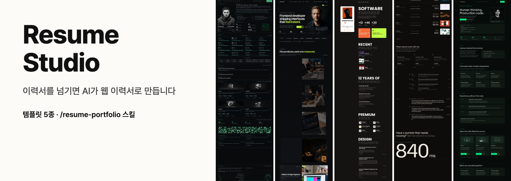
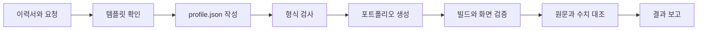

<p align="center">
  <a href="https://roadkwonai.github.io/resume-studio/"></a>
</p>

<a id="resume-studio"></a>
<h1 align="center">Resume Studio</h1>

<p align="center"><strong>템플릿을 고르고 이력서를 넘기면 AI가 내용을 옮겨 웹 이력서를 완성합니다.</strong></p>
<p align="center">템플릿 6종 · PDF, DOCX, 노션 자료 · 한국어와 영어 · 개인정보 점검 · 독립 배포</p>

<p align="center">
  <a href="https://roadkwonai.github.io/resume-studio/"></a>
  <a href="LICENSE"></a>
  <a href=".nvmrc"></a>
  <a href="gallery/package.json"></a>
  <a href=".claude/skills/resume-portfolio/SKILL.md"></a>
</p>

<p align="center">
  <a href="https://roadkwonai.github.io/resume-studio/">템플릿 미리보기</a> · <a href="#toc-1">빠른 시작</a> · <a href="#toc-3">작성 가이드</a> · <a href="#toc-4">샘플 프롬프트</a> · <a href="#toc-5">스킬 규칙</a> · <a href=".claude/skills/resume-portfolio/SKILL.md">스킬 원문</a>
</p>

사이트는 이미 만들어져 있습니다. `resume-portfolio` 스킬은 레이아웃을 새로 짜지 않고, 이력서의 사실을 `content/profile.json` 하나에 정확하게 옮기는 일을 맡습니다. 여섯 템플릿이 같은 형식을 쓰기 때문에 내용을 다시 쓰지 않고 템플릿을 바꿀 수 있습니다.

> [!IMPORTANT]
> 내가 만든 `portfolios/` 폴더, PDF, `selection.json` 은 `.gitignore` 에 들어 있습니다. 이력서, 사진, 연락처는 이 저장소를 포크해도 커밋되지 않습니다.

## 설치

**Claude Code, Codex, Antigravity** 어디서든 같은 스킬을 씁니다. 쓰는 도구에 아래 문장을 그대로 보내면 설치까지 끝납니다.

```text
https://github.com/roadkwonai/resume-studio 저장소를 내려받아 npm install 을 실행하고,
npm run skill:install 로 resume-portfolio 스킬을 설치해 줘.
끝나면 npm run studio 로 템플릿 갤러리를 열어 줘.
```

직접 설치할 때는 도구 이름만 바꿉니다. 이름을 적지 않으면 셋 다 설치합니다.

```bash
git clone https://github.com/roadkwonai/resume-studio.git
cd resume-studio
npm install
npm run skill:install -- codex
```

| 도구 | 저장소 폴더에서 | 전역 설치 위치 | 부르는 법 |
| --- | --- | --- | --- |
| Claude Code | 설치 없이 사용 | `~/.claude/skills/` | `/resume-portfolio` |
| Codex | 설치 없이 사용 | `~/.agents/skills/` | `$resume-portfolio` |
| Antigravity | 저장소를 작업 공간으로 열면 사용 | `~/.gemini/config/skills/` | 요청에 `resume-portfolio` 를 적거나 그냥 요청 |

> [!TIP]
> 이미 같은 이름의 스킬이 있으면 건너뜁니다. 바꾸려면 `npm run skill:install -- codex --force` 를 실행합니다. 설치 후 스킬이 보이지 않으면 도구를 다시 시작합니다.

<details>
<summary><strong>목차 펼치기</strong></summary>

## 목차

- [빠른 시작](#toc-1)
- [템플릿](#toc-2)
- [작성 가이드](#toc-3)
- [샘플 프롬프트](#toc-4)
- [스킬 규칙](#toc-5)
- [명령어](#toc-6)
- [구조](#toc-7)
- [배포](#toc-8)
- [개발과 라이선스](#toc-9)

</details>

---

<a id="toc-1"></a>

## 빠른 시작

[설치](#설치)를 마쳤다면 `npm run studio` 만 실행합니다. Node.js 24가 필요합니다.

```bash
git clone https://github.com/roadkwonai/resume-studio.git
cd resume-studio
npm install
npm run studio
```

http://localhost:4100 을 열면 템플릿 6종을 나란히 보고, 실제로 눌러 보고, 하나를 고를 수 있습니다. 처음 실행할 때는 빌드 때문에 몇 분 걸립니다.

> [!TIP]
> 스킬 이름을 쓰지 않아도 됩니다. "내 이력서로 사이트 만들어 줘"처럼 말로 요청해도 스킬이 실행됩니다.

<a id="toc-2"></a>

## 템플릿

[데모 사이트](https://roadkwonai.github.io/resume-studio/)에서 여섯 템플릿의 실제 화면을 데스크톱, 태블릿, 휴대폰 크기로 볼 수 있습니다.

| 템플릿 | 추천 대상 | 구성 | 준비 자료 |
| --- | --- | --- | --- |
| [Stackbit OS](https://roadkwonai.github.io/resume-studio/preview/stackbit-os/) | 기술 스택과 오픈소스 활동을 강조하려는 개발자 | 단일 페이지 | 프로필 사진, 프로젝트 이미지 |
| [Soren Hale](https://roadkwonai.github.io/resume-studio/preview/soren-hale/) | 프로젝트 사례와 글이 충분한 시니어 개발자, 프리랜서 | 다중 페이지 | 프로필 사진, 프로젝트별 대표 이미지 |
| [Sawad](https://roadkwonai.github.io/resume-studio/preview/sawad/) | 경력이 짧거나 빠르게 공개하려는 디자이너, 개발자 | 다중 페이지 | 프로필 사진, 프로젝트 썸네일 |
| [Nightly](https://roadkwonai.github.io/resume-studio/preview/nightly/) | 측정 가능한 성과가 있는 엔지니어, 컨설턴트 | 다중 페이지 | 개선 전후 수치, 대표 이미지 |
| [Kernel Dev](https://roadkwonai.github.io/resume-studio/preview/kernel-dev/) | 사진 없이 글로만 구성하려는 개발자 | 단일 페이지 | 사진 불필요 |
| [Fastfolio](https://roadkwonai.github.io/resume-studio/preview/fastfolio/) | 프로젝트 이미지와 후기가 있는 프론트엔드 개발자 | 단일 페이지 | 프로필 사진, 프로젝트 이미지 |

자료 양을 기준으로 고르면 실패가 적습니다. 프로젝트 수치가 없으면 Nightly의 핵심 장면이 빠지고, 프로젝트가 두 개뿐이면 Soren Hale의 페이지가 많이 사라집니다.

<a id="toc-3"></a>

## 작성 가이드

### 1. 자료 준비

| 자료 | 필수 여부 | 비고 |
| --- | --- | --- |
| 이력서 | 필수 | PDF, DOCX, 텍스트 모두 가능. 붙여 넣어도 됩니다 |
| 이메일 | 필수 | 이력서에 없으면 스킬이 물어봅니다 |
| 템플릿 이름 | 선택 | 말하지 않으면 갤러리를 열어 고르게 합니다 |
| 프로필 사진, 프로젝트 이미지 | 선택 | 없으면 이니셜이나 글자 면으로 대체합니다 |
| 노션, 경력기술서 | 선택 | 공개 페이지 주소나 파일을 함께 넘깁니다 |
| 지원 직무, 사이트 언어 | 선택 | 기본은 이력서 언어입니다 |

### 2. 요청

[샘플 프롬프트](#toc-4)에서 상황에 맞는 문장을 고르고 파일 경로만 바꿉니다.

### 3. 진행 과정

<details>
<summary><strong>요청이 사이트가 되는 과정</strong></summary>



</details>

| 단계 | 스킬이 하는 일 |
| --- | --- |
| 자료와 템플릿 확인 | 이력서를 읽고 템플릿을 확인합니다. 사용자가 말한 이름이 갤러리 선택보다 우선합니다 |
| `profile.json` 작성 | 규격에 맞춰 옮기고 `npm run validate` 로 검사합니다 |
| 포트폴리오 생성 | `portfolios/<이름>/` 을 만들고 사진과 PDF를 복사합니다 |
| 검증 | 빌드, 데모 내용 잔재, 1440px과 390px 화면을 확인합니다 |
| 결과 보고 | 실행 주소, 사라진 섹션, 뺀 개인정보, 자료끼리 달랐던 값을 알립니다 |

### 4. 결과 확인

보고에서 아래 항목을 확인하고 틀린 내용은 말로 고쳐 달라고 요청합니다.

- [ ] 경력 연수, 기여도, 성과 수치가 맞는가
- [ ] 자료끼리 달랐던 값 중 올바른 값을 골랐는가
- [ ] 내려받기 PDF에 공개하기 싫은 전화번호나 주소가 없는가
- [ ] 빠진 프로젝트 중 꼭 넣어야 할 것이 있는가

<a id="toc-4"></a>

## 샘플 프롬프트

예시는 Claude Code 기준입니다. Codex에서는 앞부분을 `$resume-portfolio` 로 바꾸고, Antigravity에서는 `resume-portfolio 스킬로` 라고 적습니다.

### 처음 만들기

**이력서 파일로 시작**

```text
/resume-portfolio ~/Documents/이력서.pdf 를 읽고
Stackbit OS 템플릿으로 내 이력서 사이트를 만들어 줘.
```

**템플릿 추천 받기**

```text
/resume-portfolio ~/Documents/이력서.pdf 를 보고
내 자료 양에 맞는 템플릿을 추천해 줘.
갤러리를 열어 주면 내가 직접 보고 고를게.
```

**지원 직무에 맞추기**

```text
/resume-portfolio 이력서.docx 로 Nightly 사이트를 만들어 줘.
백엔드 개발자 지원용이라 성능 개선 성과를 앞에 놓아 줘.
수치는 이력서에 있는 값만 써.
```

**사진 없이 만들기**

```text
/resume-portfolio 아래 내용을 붙여 넣을게.
사진 없이 Kernel Dev 템플릿으로 만들어 줘.

(이력서 내용 붙여 넣기)
```

### 자료 활용

**이력서와 노션 함께 쓰기**

```text
/resume-portfolio 이력서.pdf 와 노션 포트폴리오를 참고해 줘.
https://notion.so/내-포트폴리오-주소
내용이 많으니 대표 프로젝트만 추려 줘.
자료끼리 다른 값은 표로 알려 줘.
```

<details>
<summary><strong>더 많은 프롬프트 펼치기</strong></summary>

**프로필 사진과 PDF 넣기**

```text
/resume-portfolio 사진은 ~/Pictures/profile.jpg 를 쓰고
이력서 내려받기 버튼에는 이력서.pdf 를 연결해 줘.
PDF에 전화번호나 주소가 남아 있으면 알려 줘.
```

**영어 사이트 만들기**

```text
/resume-portfolio 한국어 이력서.pdf 를 바탕으로
영어 사이트를 Soren Hale 템플릿으로 만들어 줘.
회사와 서비스 이름은 공식 영문 표기를 찾아서 써.
```

### 수정과 교체

**경력 추가**

```text
/resume-portfolio 내 포트폴리오에 현재 회사 경력을 추가해 줘.
회사: ○○페이, 직무: 백엔드 개발자, 입사: 2026-03
담당 업무: 정산 배치 개발
```

**문구 다듬기**

```text
/resume-portfolio 첫 화면 문장과 소개 문단을 더 간결하게 다듬어 줘.
사실은 바꾸지 말고 바뀐 문장을 전후로 보여 줘.
```

**템플릿 바꾸기**

```text
/resume-portfolio 지금 내용 그대로 Sawad 버전도 만들어 줘.
새 템플릿에서 안 보이는 항목이 있으면 알려 줘.
```

### 점검과 배포

**공개 전 개인정보 점검**

```text
/resume-portfolio 내 포트폴리오를 공개하기 전에 점검해 줘.
사이트 문구와 내려받기 PDF에 전화번호, 주소, 생년월일이 있는지 찾아서 알려 줘.
```

**수치 대조**

```text
/resume-portfolio 사이트의 수치와 회사 이름을 이력서.pdf 원문과 대조해 줘.
원문에 없는 내용이 있으면 고치지 말고 먼저 목록으로 보여 줘.
```

**배포**

```text
/resume-portfolio 내 포트폴리오를 Vercel에 배포해 줘.
배포 전에 공개될 파일 목록과 개인정보 점검 결과를 먼저 보여 줘.
```

</details>

<a id="toc-5"></a>

## 스킬 규칙

사이트는 채용 담당자가 사실로 읽는 공개 문서입니다. 스킬은 어떤 요청에서도 아래 규칙을 지킵니다.

| 규칙 | 자료 | 처리 | 하지 않는 일 |
| --- | --- | --- | --- |
| 출처 없는 내용을 쓰지 않습니다 | 결제 시스템 개발 | 결제 시스템을 개발했습니다 | 수백만 사용자의 결제 시스템이라고 늘려 쓰기 |
| 공개해도 되는 내용만 옮깁니다 | 주민등록번호, 집 주소, 생년월일, 가족 사항, 병역 세부, 연봉 | 사이트에 옮기지 않습니다 | 전화번호를 동의 없이 공개하기 |
| 자료가 다르면 알립니다 | 기여도 70%와 100% | 기여도를 빼고 쓴 뒤 두 값을 보고합니다 | 큰 값을 말없이 쓰기 |
| 핵심만 추립니다 | 프로젝트 14개 | 대표 4~6개를 싣고 나머지는 경력 설명에 이름만 남깁니다 | 회사 성과를 통째로 지우기 |
| 빈 항목은 숨깁니다 | 후기 자료 없음 | 섹션과 메뉴를 표시하지 않습니다 | 그럴듯한 후기 지어내기 |

> [!NOTE]
> 배포는 공개 행위이므로 요청이 있을 때만 진행합니다.

자세한 기준은 스킬 문서에 있습니다.

| 문서 | 내용 |
| --- | --- |
| [SKILL.md](.claude/skills/resume-portfolio/SKILL.md) | 전체 절차와 보고 항목 |
| [profile-guide.md](.claude/skills/resume-portfolio/references/profile-guide.md) | 이력서 항목과 `profile.json` 대응표, 작성법 |
| [sources.md](.claude/skills/resume-portfolio/references/sources.md) | 자료가 여럿일 때 읽는 법, 충돌 처리, 추리기 기준 |
| [templates.md](.claude/skills/resume-portfolio/references/templates.md) | 템플릿 추천 기준 |

<a id="toc-6"></a>

## 명령어

| 명령 | 하는 일 |
| --- | --- |
| `npm run studio` | 갤러리와 템플릿 6종 실행. `-- --rebuild` 로 다시 빌드 |
| `npm run new -- <템플릿> <이름> <profile.json>` | 템플릿을 복사해 포트폴리오 생성. 템플릿 자리에 `selected` 를 쓰면 갤러리 선택을 따름 |
| `npm run validate -- <파일>` | `profile.json` 형식 검사 |
| `npm run verify -- <이름>` | 형식, 프로덕션 빌드, 데모 내용 잔재 검사 |
| `npm run dev -w @resume/portfolio-<이름>` | 내 포트폴리오 개발 모드 실행 |
| `npm run shots` | 갤러리 스크린샷 다시 촬영 |
| `npm run skill:install -- <도구>` | 스킬을 전역 폴더에 복사. 도구는 `claude`, `codex`, `antigravity` |
| `npm run pages` | GitHub Pages용 정적 사이트를 `site/` 에 생성 |
| `npm run check:template -- <id> full.ko` | 다른 사람의 데이터로 빌드해 데모 내용이 남았는지 검사 |

스킬 없이 직접 만들 때는 이렇게 합니다.

```bash
npm run new -- stackbit-os my-site path/to/profile.json
npm run verify -- my-site
npm run dev -w @resume/portfolio-my-site
```

사진과 이력서 PDF는 `portfolios/<이름>/public/profile/` 에 넣고 `profile.json` 에서 `/profile/파일명` 으로 가리킵니다.

<a id="toc-7"></a>

## 구조

| 경로 | 내용 |
| --- | --- |
| `gallery/` | 통합 웹 |
| `templates/<id>/` | 독립 실행되는 Next.js 앱 6개 |
| `templates/<id>/content/profile.json` | 사람에 관한 모든 내용. 여섯 템플릿이 같은 형식을 씁니다 |
| `templates/<id>/content/site.ko.json` | 메뉴, 버튼 같은 화면 문구 |
| `shared/profile.ts` | `profile.json` 규격. 고친 뒤 `npm run sync` |
| `portfolios/<이름>/` | 내가 만든 포트폴리오. 커밋되지 않습니다 |
| `.claude/skills/resume-portfolio/` | 스킬 원본 |
| `.agents/skills/resume-portfolio/` | Codex와 Antigravity가 읽는 사본. `npm run sync` 로 맞춥니다 |

포트는 갤러리 4100, 템플릿 4101~4106, 포트폴리오 4200부터입니다. `npm run studio` 는 localhost에서만 받습니다.

<a id="toc-8"></a>

## 배포

포트폴리오 폴더는 독립 앱이라 그대로 떼어내 어디든 배포할 수 있습니다. 밖으로 옮긴 뒤에는 그 폴더에서 `npm install` 을 실행합니다.

이 저장소의 데모 사이트는 `main` 브랜치에 푸시할 때 [GitHub Actions](.github/workflows/pages.yml)가 빌드해 GitHub Pages에 올립니다. 데모 사이트에서는 템플릿 선택을 저장할 서버가 없어 대신 복사할 문장을 보여 줍니다.

<a id="toc-9"></a>

## 개발과 라이선스

템플릿을 고쳤다면 `npm run studio -- --rebuild` 로 다시 빌드하고 `npm run shots` 로 스크린샷을 새로 찍습니다. 작업 규칙은 [AGENTS.md](AGENTS.md)에 있습니다.

[MIT LICENSE](LICENSE)를 따릅니다. 글꼴은 [Pretendard](https://github.com/orioncactus/pretendard), 아이콘은 [Lucide](https://lucide.dev)를 씁니다.
